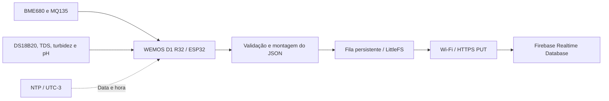

# SensorsController

**Monitoramento de qualidade do ar e da água de aquário com ESP32 e Firebase.**

O SensorsController é um firmware Arduino para **WEMOS D1 R32**. Ele reúne leituras ambientais e de água, sincroniza o relógio pela rede e mantém um histórico no Firebase Realtime Database. Antes do envio, cada operação é armazenada em uma fila na flash, para permitir novas tentativas quando a conexão falhar.

O projeto concentra a aquisição de sensores e a gravação dos dados. O controle de iluminação do sistema foi separado para outro firmware, conforme a [documentação da divisão dos projetos](docs/SPLIT_PROJECTS.md).

## Conteúdo

- [O que o firmware faz](#o-que-o-firmware-faz)
- [Hardware e pinagem](#hardware-e-pinagem)
- [Preparação e credenciais](#preparação-e-credenciais)
- [Instalação, compilação e gravação](#instalação-compilação-e-gravação)
- [Primeira execução e rotina de coleta](#primeira-execução-e-rotina-de-coleta)
- [Dados no Firebase](#dados-no-firebase)
- [Fila persistente e recuperação](#fila-persistente-e-recuperação)
- [Configuração e calibração](#configuração-e-calibração)
- [Diagnóstico](#diagnóstico)
- [Organização e documentação](#organização-e-documentação)
- [Validação e limitações](#validação-e-limitações)

## O que o firmware faz

| Área | Funcionamento |
| --- | --- |
| Ambiente | Temperatura, umidade, pressão e sensação térmica com BME680; estimativas de gases com MQ135. |
| Aquário | Temperatura da água, TDS, turbidez e pH. |
| Tempo | Sincronização por NTP, com deslocamento fixo UTC−3. |
| Histórico | Uma coleta por categoria no minuto configurado de cada hora, com proteção contra repetição no mesmo minuto. |
| Diagnóstico inicial | Um registro de estado dos sensores após a janela inicial de três minutos e com horário válido. |
| Persistência | Fila FIFO em LittleFS e reenvio ao Firebase por HTTP `PUT`. |



Leituras que falham são sinalizadas no JSON. Os campos de medição correspondentes são omitidos, em vez de reutilizar uma leitura anterior como se fosse atual.

## Hardware e pinagem

A placa indicada em `config.h` é a **WEMOS D1 R32**, com alvo Arduino `esp32:esp32:d1_uno32`. A tabela reproduz a configuração do código e o mapeamento de pinos dessa placa no core ESP32 2.0.14.

| Componente | Medição ou função | Pino no firmware | GPIO |
| --- | --- | --- | --- |
| BME680 | Temperatura, umidade e pressão do ar | SDA / SCL | 21 / 22 |
| MQ135 | Estimativas de gases após calibração | A3 | 34 |
| DS18B20 | Temperatura da água via OneWire | `ONE_WIRE_BUS` | 17 |
| Relé SSR do DS18B20 | Alimentação do sensor durante a leitura | `TEMPERATURE_SENSOR_RELAY_PIN` | 25 |
| Sensor TDS | Estimativa de sólidos dissolvidos | A2 | 35 |
| Sensor de turbidez | Leitura analógica e estimativa de NTU | A5 | 39 |
| Sensor de pH | Leitura analógica com calibração | A4 | 36 |

O relé da temperatura é acionado em nível baixo: **`LOW` liga, `HIGH` desliga**. Ele permanece desligado fora da leitura do DS18B20.

> **Limite elétrico:** as entradas analógicas do ESP32 devem respeitar **3,3 V**. A alimentação de um módulo e a tensão de sua saída analógica precisam ser verificadas separadamente.

Os modelos dos módulos TDS, turbidez, pH e relé não estão especificados no código. O repositório também não contém um esquema elétrico completo; a tabela não define alimentação, resistores ou adaptações de nível desses módulos.

## Preparação e credenciais

Você precisará de Git, Arduino IDE ou Arduino CLI, do pacote de placas ESP32 e das bibliotecas listadas abaixo. Para operar o dispositivo, também são necessários o hardware, uma rede Wi-Fi e um Firebase Realtime Database com autorização para as escritas do firmware.

### 1. Obter o projeto

```powershell
git clone https://github.com/anvmano/SensorsController.git
cd SensorsController
```

Mantenha o nome da pasta `SensorsController`, correspondente ao arquivo principal `SensorsController.ino`. As demais abas `.ino` devem permanecer na mesma pasta.

### 2. Criar a configuração local

No PowerShell, copie o exemplo **apenas se ainda não tiver um `secrets.h` configurado**:

```powershell
Copy-Item secrets.example.h secrets.h
```

Edite os quatro valores de `secrets.h`, preservando os nomes e as declarações:

| Identificador | O que preencher |
| --- | --- |
| `ssid` | Nome da sua rede Wi-Fi. |
| `password` | Senha da sua rede Wi-Fi. |
| `FIREBASE_HOST` | URL HTTPS da instância do Realtime Database, incluindo o domínio e a barra final. |
| `FIREBASE_AUTH` | Token aceito pela sua instância para autenticação REST. |

`FIREBASE_HOST` deve conter a URL base do banco; o firmware acrescenta o caminho, a extensão `.json` e o parâmetro de autenticação. Uma chave de API de um aplicativo Firebase não é, por si só, substituta do token esperado por esse código.

O arquivo público [secrets.example.h](secrets.example.h) contém somente placeholders. O `.gitignore` exclui `secrets.h`, arquivos `.env`, chaves privadas e configurações locais. Mantenha as credenciais reais fora de comentários, exemplos e documentação.

### 3. Preparar o Firebase

Use **Realtime Database**, pois o firmware escreve por sua API REST. A autorização utilizada precisa permitir `PUT` nos caminhos de histórico e de estado dos sensores descritos em [Dados no Firebase](#dados-no-firebase).

As regras e o provisionamento de autenticação do banco dependem da sua instância e não estão incluídos no repositório. Não é necessário tornar o banco público para usar este projeto.

O código envia o valor de `FIREBASE_AUTH` no parâmetro `auth` e não implementa obtenção nem renovação de tokens. Se você usar um Firebase ID token, ele expira e exigirá renovação fora deste firmware. Consulte a [documentação oficial de autenticação REST](https://firebase.google.com/docs/database/rest/auth) para escolher uma credencial compatível com sua configuração.

## Instalação, compilação e gravação

### Ambiente validado

Estas são as versões usadas na compilação da publicação inicial. Elas servem como referência reproduzível; outras versões não foram verificadas.

| Pacote | Versão | Uso |
| --- | --- | --- |
| Core ESP32 (`esp32:esp32`) | 2.0.14 | Placa, Wi-Fi, HTTPS, ADC, LittleFS e NVS. |
| Adafruit BME680 Library | 2.0.6 | Leitura do BME680. |
| Adafruit BusIO | 1.17.4 | Dependência Adafruit. |
| Adafruit Unified Sensor | 1.1.15 | Dependência Adafruit. |
| ArduinoJson | 7.4.3 | Serialização dos dados e registros da fila. |
| DallasTemperature | 4.0.6 | Leitura do DS18B20. |
| MQUnifiedsensor | 3.0.0 | Calibração e estimativas do MQ135. |
| NTPClient | 3.2.1 | Sincronização do relógio. |
| OneWire | 2.3.8 | Barramento do DS18B20. |
| Time (`TimeLib.h`) | 1.6.1 | Extração de data e hora. |

`Wire`, `WiFi`, `HTTPClient`, `WiFiClientSecure`, `WiFiUdp`, `LittleFS` e `Preferences` pertencem ao core ESP32. Não há dependência de uma biblioteca cliente Firebase: a comunicação é feita por REST.

### Pela Arduino IDE

1. Adicione o [índice estável de placas ESP32](https://espressif.github.io/arduino-esp32/package_esp32_index.json) às URLs adicionais do Gerenciador de Placas, conforme o [guia oficial da Espressif](https://docs.espressif.com/projects/arduino-esp32/en/latest/installing.html).
2. Instale **esp32 by Espressif Systems**, versão **2.0.14**.
3. No Gerenciador de Bibliotecas, instale os pacotes e versões da tabela.
4. Abra `SensorsController.ino` e selecione **WEMOS D1 R32**.
5. Confirme que criou o `secrets.h` e compile com **Verificar**.
6. Para gravar, conecte a placa, selecione a porta correspondente e use **Carregar**.
7. Abra o monitor serial em **9600 baud**.

Use um esquema de partições com área de filesystem para a fila LittleFS. A compilação inicial usou a partição padrão do alvo; evite opções sem essa área.

### Pela Arduino CLI — PowerShell

Execute na pasta do projeto. O índice abaixo é o estável publicado pela Espressif:

```powershell
$esp32Index = "https://espressif.github.io/arduino-esp32/package_esp32_index.json"
arduino-cli core update-index --additional-urls $esp32Index
arduino-cli core install esp32:esp32@2.0.14 --additional-urls $esp32Index
arduino-cli lib update-index

arduino-cli lib install "Adafruit BME680 Library@2.0.6"
arduino-cli lib install "Adafruit BusIO@1.17.4" "Adafruit Unified Sensor@1.1.15"
arduino-cli lib install "ArduinoJson@7.4.3" "DallasTemperature@4.0.6"
arduino-cli lib install "MQUnifiedsensor@3.0.0" "NTPClient@3.2.1"
arduino-cli lib install "OneWire@2.3.8" "Time@1.6.1"

arduino-cli compile --warnings all --fqbn esp32:esp32:d1_uno32 --build-path build .
```

Para localizar a porta, gravar e acompanhar a execução:

```powershell
arduino-cli board list

# Substitua COM3 pela porta da sua placa. Compile antes de gravar.
arduino-cli upload --fqbn esp32:esp32:d1_uno32 --port COM3 --build-path build .
arduino-cli monitor --port COM3 --config baudrate=9600
```

O diretório `build/` está ignorado pelo Git. Compilar dispensa uma placa conectada; upload e validação de funcionamento exigem o dispositivo físico.

## Primeira execução e rotina de coleta

### Na inicialização

O firmware abre a serial, inicializa a fila LittleFS, configura o ADC e deixa o relé da temperatura desligado. Depois inicializa MQ135 e BME680, tenta conectar ao Wi-Fi e sincroniza o relógio via NTP.

O hostname de rede é `SensorsController`. O deslocamento de horário é fixo em **UTC−3**, e o relógio só é considerado válido quando o ano é pelo menos `MIN_VALID_YEAR` — atualmente 2024.

### O que esperar em seguida

| Momento ou condição | Comportamento esperado |
| --- | --- |
| Primeiros dois minutos de uptime | Aguarda o aquecimento configurado antes da primeira tentativa de calibração automática do MQ135. |
| Falha na calibração do MQ135 | Nova tentativa após o intervalo configurado de dez minutos. |
| Após três minutos de uptime, com horário válido | Tenta coletar e enfileirar um registro de estado dos sensores. O envio depende da fila e da conexão. |
| Minuto `00` de cada hora | Coleta o histórico de ar e depois o de aquário. Não há histórico imediato no boot. |
| Wi-Fi desconectado | Tenta reconectar em intervalos de 30 segundos; as operações já persistidas aguardam reenvio. |
| Relógio inválido | Adia a geração de novos registros de histórico e de estado; continua processando a fila existente. |

Os tempos são condições da agenda, não prazos exatos: leituras, pausas e chamadas de rede podem atrasar a execução.

No aquário, a sequência é **pH → pausa de 10 s → turbidez → pausa de 10 s → DS18B20 → pausa de 10 s → TDS**. A ordem ajuda a reduzir a interferência do TDS na leitura de pH. O DS18B20 é energizado pelo relé, aguarda três segundos, passa por detecção e tentativas de leitura e é desligado ao terminar.

## Dados no Firebase

O firmware organiza registros por data e hora, com nomes de campos sensíveis a maiúsculas e minúsculas:

```text
/
├── historico/
│   ├── AirQuality/DD-MM-AAAA/HH-MM/SensorsController_AirQuality
│   └── Aquario/DD-MM-AAAA/HH-MM/SensorsController_Aquario
└── statusSensores/
    └── DD-MM-AAAA/HH-MM/SensorsController_boot_<millis>
```

As escritas usam `PUT` em filhos com identificadores definidos pelo firmware. Repetir uma operação pendente atualiza o mesmo destino, evitando criar uma nova chave a cada tentativa de envio.

### Qualidade do ar — `AirQuality`

| Campos | Significado |
| --- | --- |
| `bme680Ok`, `mq135Ok` | Indicam se cada grupo de leituras está disponível. |
| `temperatura`, `sensacaoTermica` | Temperatura e sensação térmica em °C, quando o BME680 é válido. |
| `umidade`, `pressao` | Umidade relativa em % e pressão em hPa. |
| `Aceton`, `Alcohol`, `CO`, `CO2`, `NH4`, `Toluen` | Estimativas produzidas pela configuração do MQ135, somente após calibração e leitura válidas. |

Exemplo **fictício** de um registro com BME680 disponível e MQ135 ainda indisponível:

```json
{
  "bme680Ok": true,
  "mq135Ok": false,
  "temperatura": 25.4,
  "sensacaoTermica": 25.4,
  "umidade": 55.0,
  "pressao": 1013.2
}
```

O canal de gás interno do BME680 não é gravado pelo firmware atual.

### Água — `Aquario`

| Grupo | Campos publicados quando a leitura é válida |
| --- | --- |
| Estado das leituras | `ds18b20Ok`, `tdsOk`, `turbidezOk`, `phOk` são sempre incluídos. |
| Temperatura | `temperaturaDS18B20`, em °C. |
| TDS | `TDS`, `tdsPpm`, `tdsMgL`, `tdsRaw`, `tdsVoltage`, `tdsCompensationVoltage`, `tdsCompensationTemperature`. |
| Turbidez | `Turbidez`, `turbidezNtu`, `turbidezRaw`, `turbidezVoltage`, `turbidezSensorVoltage`. |
| pH | `PH`, `phRaw`, `phVoltage`, `phSensorVoltage`. |

`TDS`, `tdsPpm` e `tdsMgL` recebem o mesmo valor calculado. `Turbidez` guarda a leitura ADC, enquanto `turbidezNtu` guarda a estimativa convertida. Para compensar o TDS, o firmware usa a temperatura válida do DS18B20 ou **25 °C** quando ela está indisponível.

### Estado inicial — `statusSensores`

O registro contém `tipo`, `uptimeMs` e o objeto `status_de_cada_sensor`, com os grupos `BME680`, `MQ135`, `DS18B20`, `PH`, `Turbidez` e `TDS`. Cada grupo informa `ok` e acrescenta suas medições quando válidas.

Esse registro facilita conferir quais sensores responderam após a inicialização. Ele fica fora de `/historico` e não substitui a coleta horária.

## Fila persistente e recuperação

A fila fica no arquivo `/firebase-queue.jsonl`, dentro da partição LittleFS da placa. Cada entrada guarda destino, conteúdo JSON, identificador, tipo, timestamp e método HTTP.

| Propriedade | Comportamento atual |
| --- | --- |
| Ordem | FIFO: operações antigas são tratadas primeiro. |
| Capacidade | Até **100 operações** e **64 KiB**, respeitando o limite atingido primeiro. |
| Reenvio | Uma operação por chamada elegível de processamento, com intervalo base de 30 s e espera progressiva após falhas, limitada a 1 h. |
| Confirmação | A entrada é removida somente após resposta HTTP `200` e atualização bem-sucedida da fila. |
| Fila cheia ou falha de gravação | Rejeita a nova operação e registra falha crítica na serial. |
| Atualização do arquivo | Usa arquivo temporário e renomeação; na inicialização, tenta recuperar um temporário válido. |

A capacidade é finita: uma desconexão prolongada pode impedir o armazenamento de novas coletas. Não há garantia de retenção ilimitada nem de ausência de perdas em todas as falhas de energia.

> **Primeiro uso da flash:** se o filesystem não montar e ainda não houver o marcador de inicialização em NVS, o firmware pode formatar a partição LittleFS. Essa operação pode apagar conteúdo anterior da partição. Após marcar a inicialização, falhas de montagem não provocam formatação automática.

## Configuração e calibração

[config.h](config.h) centraliza os parâmetros de hardware e execução. Os valores fornecidos refletem a configuração existente do projeto; a calibração precisa corresponder aos sensores e à montagem usados.

| Parâmetro ou grupo | Valor atual | Efeito |
| --- | --- | --- |
| `ADC_BIT_RESOLUTION` / `ADC_REFERENCE_VOLTAGE` | 12 bits / 3,3 V | Conversão das leituras analógicas. |
| `HOURLY_RECORD_MINUTE` | `0` | Minuto da coleta horária. |
| `NTP_TIME_OFFSET_SECONDS` | `-10800` | Deslocamento fixo UTC−3. |
| `MQ135_WARMUP_MS` | `120000` | Espera inicial para calibração do MQ135. |
| `RATIO_MQ135_CLEAN_AIR` | `3.6` | Referência usada na calibração do MQ135. |
| `TDS_SAMPLE_COUNT` / `TDS_SAMPLE_INTERVAL_MS` | 100 / 20 ms | Média das amostras de TDS. |
| `PH_SAMPLE_COUNT` / `PH_SAMPLE_INTERVAL_MS` | 100 / 20 ms | Amostragem de pH, filtrada por mediana. |
| `PH_CALIBRATION_*` | Referências para pH 4, 7 e 10; inclinações ácido/alcalino | Conversão segmentada da tensão em pH. |
| `TURBIDEZ_ADC_TO_SENSOR_VOLTAGE_FACTOR` | `1.0` | Fator usado para obter a tensão do sensor de turbidez. |
| `PH_ADC_TO_SENSOR_VOLTAGE_FACTOR` | `1.0` | Fator usado para obter a tensão do sensor de pH. |

O pH usa atenuação `ADC_11db`. As estimativas do MQ135 e da turbidez dependem das curvas e parâmetros do código; compilação bem-sucedida não valida a precisão das medições. Alterações de divisor de tensão ou módulo analógico exigem conferir os fatores de conversão e a calibração, respeitando o limite elétrico do ESP32.

## Diagnóstico

Use o monitor serial em **9600 baud**. A coleta do aquário inclui pausas deliberadas, portanto pode levar mais de 30 segundos para terminar.

| Sintoma | O que conferir |
| --- | --- |
| Erro de compilação citando `secrets.h` | Crie o arquivo a partir de `secrets.example.h`, na mesma pasta do sketch. |
| Cabeçalho de biblioteca não encontrado | Instale o pacote correspondente da tabela; `TimeLib.h` vem da biblioteca **Time**. |
| Timeout de Wi-Fi | Revise SSID e senha localmente, disponibilidade da rede e sinal. A tentativa inicial tem timeout de 20 s. |
| Nenhum histórico logo após ligar | É esperado: a gravação horária aguarda horário NTP válido e o minuto configurado. O estado inicial tem sua própria janela de três minutos. |
| `mq135Ok` permanece `false` | Aguarde o aquecimento e verifique os resultados de calibração na serial, a conexão e a referência de ar limpo. |
| BME680 indisponível | Confira SDA/SCL e o módulo. A inicialização tem timeout de 15 s; a falha é sinalizada sem bloquear permanentemente o boot. |
| DS18B20 não detectado | Confira GPIO17, alimentação durante a leitura e acionamento do relé em GPIO25. O código realiza tentativas de detecção e leitura. |
| Firebase fica pendente | Confira conexão, URL do Realtime Database, token e regras de escrita. A serial informa o código HTTP retornado. |
| Falha crítica de LittleFS ou fila cheia | Revise a partição de filesystem e os logs; restaure as condições de armazenamento/envio antes de esperar novas coletas persistidas. |

Ao compartilhar diagnósticos, remova senhas, tokens e URLs autenticadas. O firmware usa o token do Firebase em um parâmetro de URL.

## Organização e documentação

```text
SensorsController/
├── SensorsController.ino   # Bibliotecas, globais, setup() e loop()
├── config.h                # Pinagem, tempos, limites e calibrações
├── secrets.example.h       # Modelo público de credenciais
├── secrets.h               # Configuração local, ignorada pelo Git
├── 01_Utils.ino            # Data, hora e caminhos de gravação
├── 02_Connectivity.ino     # Conexão Wi-Fi
├── 03_AirSensors.ino       # BME680, MQ135 e sensação térmica
├── 04_AquariumSensors.ino  # DS18B20, TDS, turbidez e pH
├── 05_Firebase.ino         # Payloads e controle do histórico por categoria
├── 06_Tasks.ino            # Rotina periódica do loop
├── 07_FirebaseQueue.ino    # Persistência, recuperação e envio da fila
└── docs/                   # Referência técnica detalhada
```

| Documento | Conteúdo |
| --- | --- |
| [Arquitetura](docs/ARCHITECTURE_AI.md) | Componentes, fluxo de execução, dados e riscos técnicos. |
| [Mapa de dependências](docs/DEPENDENCY_MAP.md) | Relações entre arquivos, bibliotecas e funções. |
| [Regras de funcionamento](docs/BUSINESS_RULES.md) | Ordem das leituras, validações e comportamento a preservar. |
| [Contexto rápido](docs/AI_QUICK_CONTEXT.md) | Referência resumida do firmware. |
| [Divisão dos projetos](docs/SPLIT_PROJECTS.md) | Separação entre sensores e iluminação. |

## Validação e limitações

A publicação inicial foi compilada com Arduino CLI **1.5.1**, core ESP32 **2.0.14**, alvo `esp32:esp32:d1_uno32` e credenciais substituídas por placeholders:

| Recurso | Uso informado pelo compilador |
| --- | --- |
| Flash do aplicativo | **1.007.169 bytes — 76%** de 1.310.720 bytes. |
| RAM para variáveis globais | **47.836 bytes — 14%** de 327.680 bytes. |
| RAM restante para variáveis locais | 279.844 bytes, antes das alocações em execução. |

Houve avisos na OneWire, LittleFS e no core ESP32. Não há suíte de testes automatizados no repositório. A compilação não comprova o funcionamento dos sensores, Wi-Fi, Firebase, persistência sob queda de energia ou precisão das calibrações; esses pontos exigem validação física.

**Segurança da conexão:** o firmware atual usa `client.setInsecure()`, portanto o HTTPS não valida o certificado do servidor. O token do Firebase é enviado na query string. Esses comportamentos existentes foram mantidos na publicação e precisam ser considerados ao configurar o dispositivo e proteger as credenciais.
