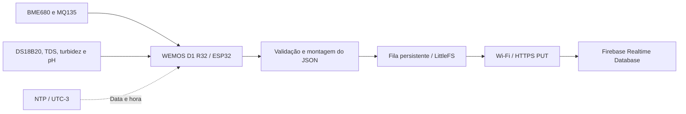

# SensorsController

**Monitoramento de qualidade do ar e da água de aquário com ESP32 e Firebase.**

O SensorsController é um firmware Arduino para **WEMOS D1 R32**. Ele reúne leituras ambientais e de água, sincroniza o relógio pela rede e mantém um histórico no Firebase Realtime Database. Antes do envio, cada operação é armazenada em uma fila na flash, para permitir novas tentativas quando a conexão falhar.

O projeto concentra a aquisição de sensores e a gravação dos dados. O controle de iluminação do sistema foi separado para outro firmware, conforme a [documentação da divisão dos projetos](docs/SPLIT_PROJECTS.md).

## Conteúdo

- [Funcionalidades](#funcionalidades)
- [Como funciona](#como-funciona)
- [Hardware e pinagem](#hardware-e-pinagem)
- [Requisitos e dependências](#requisitos-e-dependências)
- [Instalação e configuração](#instalação-e-configuração)
- [Operação](#operação)
- [Dados e integrações](#dados-e-integrações)
- [Configurações e calibração](#configurações-e-calibração)
- [Falhas e recuperação](#falhas-e-recuperação)
- [Diagnóstico](#diagnóstico)
- [Estrutura do projeto](#estrutura-do-projeto)
- [Validação e limitações](#validação-e-limitações)
- [Documentação complementar](#documentação-complementar)

## Funcionalidades

| Recurso | Comportamento implementado |
| --- | --- |
| Ambiente | Temperatura, umidade, pressão e sensação térmica com BME680; estimativas de gases com MQ135. |
| Aquário | Temperatura da água, TDS, turbidez e pH. |
| Tempo | Sincronização por NTP, com deslocamento fixo UTC−3. |
| Histórico | Uma coleta por categoria no minuto configurado de cada hora, com proteção contra repetição no mesmo minuto. |
| Diagnóstico inicial | Um registro de estado dos sensores após a janela inicial de três minutos e com horário válido. |
| Persistência | Fila FIFO em LittleFS e reenvio ao Firebase por HTTP `PUT`. |

## Como funciona



No `setup()`, o firmware inicializa a serial e a fila LittleFS, configura o ADC e o relé, prepara os sensores, tenta conectar ao Wi-Fi e sincroniza o relógio. O `loop()` chama `executarTarefasPeriodicas()`, que cuida da reconexão, calibração, agenda de coleta e processamento da fila.

As medições são feitas localmente. O NTP fornece data e hora; o Firebase recebe os dados por REST. Novos registros de histórico e de estado exigem horário válido, enquanto operações já persistidas continuam elegíveis para envio. As leituras são armazenadas na fila antes da tentativa HTTP.

Quando uma função de leitura informa falha, o JSON registra o estado e omite os campos de medição correspondentes. O TDS pode usar a temperatura de compensação alternativa descrita em Dados e integrações.

## Hardware e pinagem

A placa declarada em `config.h` é **WEMOS D1 R32** e o alvo de compilação documentado é `esp32:esp32:d1_uno32`. Isso identifica a configuração do firmware; o modelo físico e a montagem não foram verificados nesta revisão.

O mapeamento A2–A5 foi conferido em `variants/d1_uno32/pins_arduino.h` do core ESP32 **2.0.14**:

| Componente | Função | Pino no código | GPIO ou interface | Observação |
| --- | --- | --- | --- | --- |
| BME680 | Temperatura, umidade e pressão do ar | `I2C_SDA_PIN` / `I2C_SCL_PIN` | I2C: SDA 21 / SCL 22 | Interface inicializada explicitamente por `Wire.begin()`. |
| MQ135 | Estimativas de gases após calibração | `MQ135_PIN` = A3 | GPIO34 / ADC | Leitura habilitada após calibração do MQ135. |
| DS18B20 | Temperatura da água | `ONE_WIRE_BUS` = 17 | GPIO17 / OneWire | Alimentado durante a leitura, por meio do relé. |
| Relé SSR do DS18B20 | Controle da alimentação do sensor | `TEMPERATURE_SENSOR_RELAY_PIN` = 25 | GPIO25 / saída digital | **`LOW` liga; `HIGH` desliga**. Desligado fora da leitura. |
| Sensor TDS | Estimativa de sólidos dissolvidos | `TDS_SENSOR_PIN` = A2 | GPIO35 / ADC | Compensação por temperatura. |
| Sensor de turbidez | Leitura analógica e estimativa de NTU | `TURBIDEZ_SENSOR_PIN` = A5 | GPIO39 / ADC | Conversão e limites definidos no firmware. |
| Sensor de pH | Leitura analógica com calibração | `PH_SENSOR_PIN` = A4 | GPIO36 / ADC | Usa atenuação `ADC_11db`. |

> **Limite elétrico:** as entradas analógicas do ESP32 devem respeitar **3,3 V**. A alimentação de um módulo e a tensão de sua saída analógica precisam ser verificadas separadamente.

Os modelos dos módulos TDS, turbidez, pH e relé não estão especificados no código. Não há esquema elétrico completo no repositório; a tabela não define alimentação, resistores ou adaptações de nível desses módulos.

## Requisitos e dependências

Para **compilar**, use Git, Arduino IDE ou Arduino CLI, o core ESP32 e as bibliotecas abaixo. Compilar dispensa uma placa conectada. A referência de CLI da compilação histórica é **1.5.1**.

Para **operar**, são necessários a placa e os sensores montados, uma rede Wi-Fi, acesso ao servidor NTP e um Firebase Realtime Database com autenticação compatível e permissão de escrita. Upload e validação física exigem o dispositivo conectado.

As versões diretas estão registradas na documentação e na compilação histórica da publicação inicial. O inventário local foi conferido nesta revisão, sem instalar pacotes nem recompilar. Dependências transitivas apenas inventariadas são identificadas separadamente.

| Dependência | Versão de referência | Uso | Evidência da versão |
| --- | --- | --- | --- |
| Core ESP32 (`esp32:esp32`) | 2.0.14 | Placa, Wi-Fi, HTTPS, ADC, LittleFS e NVS. | Compilação histórica e inventário local. |
| Adafruit BME680 Library | 2.0.6 | Leitura do BME680. | Ambiente da compilação histórica documentado; inventário local. |
| Adafruit BusIO | 1.17.4 | Dependência transitiva Adafruit. | Versão instalada conferida; sem validação isolada. |
| Adafruit Unified Sensor | 1.1.15 | Dependência transitiva Adafruit. | Versão instalada conferida; sem validação isolada. |
| ArduinoJson | 7.4.3 | JSON dos dados e da fila. | Ambiente da compilação histórica documentado; inventário local. |
| DallasTemperature | 4.0.6 | Leitura do DS18B20. | Ambiente da compilação histórica documentado; inventário local. |
| MQUnifiedsensor | 3.0.0 | Calibração e estimativas do MQ135. | Ambiente da compilação histórica documentado; inventário local. |
| NTPClient | 3.2.1 | Sincronização do relógio. | Ambiente da compilação histórica documentado; inventário local. |
| OneWire | 2.3.8 | Barramento do DS18B20. | Ambiente da compilação histórica documentado; inventário local. |
| Time (`TimeLib.h`) | 1.6.1 | Extração de data e hora. | Ambiente da compilação histórica documentado; inventário local. |

`Wire`, `WiFi`, `HTTPClient`, `WiFiClientSecure`, `WiFiUdp`, `LittleFS` e `Preferences` pertencem ao core ESP32. O Firebase é acessado por REST, sem biblioteca cliente Firebase. Outras versões de core e bibliotecas não foram verificadas.

## Instalação e configuração

### 1. Obter o projeto

```powershell
git clone https://github.com/anvmano/SensorsController.git SensorsController
Set-Location -LiteralPath 'SensorsController'
```

Mantenha a pasta `SensorsController`, correspondente ao sketch principal `SensorsController.ino`. As demais abas `.ino` devem permanecer na mesma pasta.

### 2. Preparar as dependências

Na Arduino IDE, adicione o [índice estável de placas ESP32](https://espressif.github.io/arduino-esp32/package_esp32_index.json) às URLs adicionais do Gerenciador de Placas, conforme o [guia oficial da Espressif](https://docs.espressif.com/projects/arduino-esp32/en/latest/installing.html). Instale **esp32 by Espressif Systems 2.0.14** e, no Gerenciador de Bibliotecas, os pacotes e versões da seção anterior.

Pela Arduino CLI, execute os comandos no PowerShell, dentro da pasta do projeto:

```powershell
$esp32Index = "https://espressif.github.io/arduino-esp32/package_esp32_index.json"
arduino-cli core update-index --additional-urls $esp32Index
arduino-cli core install esp32:esp32@2.0.14 --additional-urls $esp32Index
arduino-cli lib update-index

arduino-cli lib install "Adafruit BME680 Library@2.0.6"
arduino-cli lib install "Adafruit BusIO@1.17.4" "Adafruit Unified Sensor@1.1.15"
arduino-cli lib install "ArduinoJson@7.4.3" "DallasTemperature@4.0.6"
arduino-cli lib install "MQUnifiedsensor@3.0.0" "NTPClient@3.2.1"
arduino-cli lib install "OneWire@2.3.8" "Time@1.6.1"
```

### 3. Configurar credenciais e serviços

Crie `secrets.h` a partir do exemplo público, preservando um arquivo local já existente:

```powershell
if (-not (Test-Path -LiteralPath 'secrets.h')) {
    Copy-Item -LiteralPath 'secrets.example.h' -Destination 'secrets.h'
}
```

Edite somente os quatro valores em `secrets.h`, mantendo os nomes, tipos e declarações:

| Identificador real | O que preencher | Formato ou condição |
| --- | --- | --- |
| `ssid` | Nome da sua rede Wi-Fi. | String na declaração `const char*`. |
| `password` | Senha da sua rede Wi-Fi. | String na declaração `const char*`. |
| `FIREBASE_HOST` | URL base da instância do Realtime Database. | String da macro; use HTTPS, domínio do banco e barra final. Não inclua o caminho de um registro nem `.json`. |
| `FIREBASE_AUTH` | Credencial aceita pela sua instância para autenticação REST. | String da macro; o firmware a envia no parâmetro `auth`. |

O firmware acrescenta à URL base o caminho, a extensão `.json` e a autenticação. Uma chave de API de um aplicativo Firebase não é, por si só, substituta do token esperado por esse código.

Use **Realtime Database** e autorize `PUT` nos caminhos de [Dados e integrações](#dados-e-integrações). As regras e o provisionamento de autenticação dependem da sua instância e não estão incluídos no repositório. Não é necessário tornar o banco público.

O código não implementa obtenção nem renovação de tokens. Se você usar um Firebase ID token, ele expira e exigirá renovação fora deste firmware. Consulte a [documentação oficial de autenticação REST](https://firebase.google.com/docs/database/rest/auth) para escolher uma credencial compatível.

[secrets.example.h](secrets.example.h) contém apenas placeholders. O [.gitignore](.gitignore) exclui `secrets.h`, arquivos `.env`, chaves privadas e configurações locais. Mantenha os valores reais fora de comentários, exemplos e documentação.

### 4. Compilar e gravar

Na IDE, abra `SensorsController.ino`, selecione **WEMOS D1 R32** e use **Verificar**. Para gravar, conecte a placa, selecione a porta e use **Carregar**. O monitor serial deve ficar em **9600 baud**.

Use um esquema de partições com área de filesystem para LittleFS. A compilação histórica usou a partição padrão do alvo; evite esquemas sem essa área.

Pela CLI, com `secrets.h` já configurado:

```powershell
arduino-cli compile --warnings all --fqbn esp32:esp32:d1_uno32 --build-path build .
```

Conecte a placa e identifique a porta. Substitua `SUA_PORTA` pela porta do dispositivo:

```powershell
arduino-cli board list
arduino-cli upload --fqbn esp32:esp32:d1_uno32 --port SUA_PORTA --input-dir build .
arduino-cli monitor --port SUA_PORTA --config baudrate=9600
```

O upload exige compilação anterior; `--input-dir build` seleciona os binários gerados na etapa anterior. `build/` está ignorado pelo Git. **Os binários incorporam a configuração local de `secrets.h`** e devem ser tratados como arquivos que podem conter credenciais.

## Operação

### Primeira execução

O firmware abre a serial, inicializa a fila LittleFS, configura o ADC e deixa o relé da temperatura desligado. Depois inicializa MQ135 e BME680, tenta conectar ao Wi-Fi e sincroniza o relógio via NTP.

O hostname de rede é `SensorsController`. O deslocamento de horário é fixo em **UTC−3**, e o relógio só é considerado válido quando o ano é pelo menos `MIN_VALID_YEAR` — atualmente 2024.

### Rotina de funcionamento

| Evento ou condição | Comportamento configurado |
| --- | --- |
| Primeiros dois minutos de uptime | Aguarda o aquecimento configurado antes da primeira tentativa de calibração automática do MQ135. |
| Falha na calibração do MQ135 | Nova tentativa após o intervalo configurado de dez minutos. |
| Após três minutos de uptime, com horário válido | Tenta coletar e enfileirar um registro de estado dos sensores. O envio depende da fila e da conexão. |
| Minuto `00` de cada hora | Coleta o histórico de ar e depois o de aquário. Não há histórico imediato no boot. |
| Wi-Fi desconectado | Tenta reconectar em intervalos de 30 segundos; as operações já persistidas aguardam reenvio. |
| Relógio inválido | Adia a geração de novos registros de histórico e de estado; continua processando a fila existente. |

Os tempos são condições da agenda, não prazos exatos: leituras, pausas e chamadas de rede podem atrasar a execução.

### Sequência de coleta do aquário

No aquário, a sequência é **pH → pausa de 10 s → turbidez → pausa de 10 s → DS18B20 → pausa de 10 s → TDS**. A ordem ajuda a reduzir a interferência do TDS na leitura de pH. O DS18B20 é energizado pelo relé, aguarda três segundos, passa por detecção e tentativas de leitura e é desligado ao terminar.

O DS18B20 tem até cinco tentativas de detecção e cinco de leitura; a primeira leitura é descartada conforme a configuração atual. O TDS é lido por último e não possui chaveamento por relé neste firmware.

O registro inicial é considerado concluído quando foi persistido na fila, mesmo que o envio ainda esteja pendente. Se a persistência desse registro falhar, a agenda permite outra tentativa após 30 s. Essa rotina tem prioridade sobre a coleta horária na volta do loop em que é executada.

## Dados e integrações

O firmware produz medições locais e escreve no Firebase Realtime Database por **HTTPS REST `PUT`**, com corpo JSON. O NTP é uma consulta externa de horário. Não há consumidor dos registros Firebase implementado neste repositório; a documentação da separação da iluminação não comprova uma integração de consumo desses dados.

O firmware organiza registros por data e hora, com nomes de campos sensíveis a maiúsculas e minúsculas:

```text
/
├── historico/
│   ├── AirQuality/DD-MM-AAAA/HH-MM/SensorsController_AirQuality
│   └── Aquario/DD-MM-AAAA/HH-MM/SensorsController_Aquario
└── statusSensores/
    └── DD-MM-AAAA/HH-MM/SensorsController_boot_<millis>
```

As escritas usam `PUT` em filhos com identificadores definidos pelo firmware. Repetir uma operação pendente atualiza o mesmo destino, evitando criar uma nova chave a cada tentativa de envio.

### Qualidade do ar — `AirQuality`

| Campo ou grupo | Tipo/unidade | Significado e condição de presença |
| --- | --- | --- |
| `bme680Ok`, `mq135Ok` | Booleanos | Sempre presentes; resultado das respectivas funções de leitura. |
| `temperatura`, `sensacaoTermica` | Números / °C | Temperatura e sensação térmica, se `bme680Ok` for verdadeiro. |
| `umidade` | Número / % | Umidade relativa, se `bme680Ok` for verdadeiro. |
| `pressao` | Número / hPa | Pressão convertida de Pa no firmware, se `bme680Ok` for verdadeiro. |
| `Aceton`, `Alcohol`, `CO`, `CO2`, `NH4`, `Toluen` | Números / estimativas da biblioteca | Incluídos se `mq135Ok` for verdadeiro. A função exige calibração; não faz validação independente de cada valor de gás. |

Exemplo **fictício** de um registro com BME680 disponível e MQ135 ainda indisponível:

```json
{
  "bme680Ok": true,
  "mq135Ok": false,
  "temperatura": 25.4,
  "sensacaoTermica": 25.4,
  "umidade": 55.0,
  "pressao": 1013.2
}
```

O canal de gás interno do BME680 não é gravado pelo firmware atual.

### Água — `Aquario`

| Campo ou grupo | Tipo/unidade | Significado e condição de presença |
| --- | --- | --- |
| `ds18b20Ok`, `tdsOk`, `turbidezOk`, `phOk` | Booleanos | Sempre presentes; estado de cada leitura. |
| `temperaturaDS18B20` | Número / °C | Temperatura da água, somente se `ds18b20Ok`. |
| `TDS`, `tdsPpm`, `tdsMgL` | Números / mesma estimativa de TDS | Os três campos recebem o mesmo valor calculado, somente se `tdsOk`. Os nomes de unidade são preservados pelo contrato existente. |
| `tdsRaw` | Inteiro / contagem ADC | Média arredondada das amostras de TDS, somente se `tdsOk`. |
| `tdsVoltage`, `tdsCompensationVoltage` | Números / V | Tensão ADC e tensão compensada por temperatura, somente se `tdsOk`. |
| `tdsCompensationTemperature` | Número / °C | Temperatura usada na compensação: DS18B20 válido ou alternativa de **25 °C**, somente se `tdsOk`. |
| `Turbidez`, `turbidezNtu` | Números / NTU estimado | Ambos recebem `turbidityNtu`, somente se `turbidezOk`. |
| `turbidezRaw` | Inteiro / contagem ADC | Mediana das amostras de turbidez, somente se `turbidezOk`. |
| `turbidezVoltage`, `turbidezSensorVoltage` | Números / V | Tensão ADC e tensão após o fator de conversão, somente se `turbidezOk`. |
| `PH` | Número / pH | Resultado da calibração segmentada, somente se `phOk`. |
| `phRaw` | Inteiro / contagem ADC | Mediana das amostras de pH, somente se `phOk`. |
| `phVoltage`, `phSensorVoltage` | Números / V | Tensão ADC e tensão após o fator de conversão, somente se `phOk`. |

### Estado inicial — `statusSensores`

O registro contém `tipo`, `uptimeMs` e o objeto `status_de_cada_sensor`, com os grupos `BME680`, `MQ135`, `DS18B20`, `PH`, `Turbidez` e `TDS`. Cada grupo informa `ok` e acrescenta suas medições quando válidas.

Esse registro facilita conferir quais sensores responderam após a inicialização. Ele fica fora de `/historico` e não substitui a coleta horária.

| Campo ou interface | Tipo/unidade | Significado e condição de presença |
| --- | --- | --- |
| `tipo` | String | Valor literal `validacao_pos_boot`. |
| `uptimeMs` | Inteiro / ms | Valor de `millis()` na montagem do registro. |
| `status_de_cada_sensor` | Objeto | Contém os seis grupos de sensores citados acima. |
| `status_de_cada_sensor.<grupo>.ok` | Booleano | Sempre presente em cada grupo. |
| `status_de_cada_sensor.MQ135.calibrado` | Booleano | Estado da calibração do MQ135, sempre presente nesse grupo. |
| Demais campos de cada grupo | Números / unidades das medições | Incluídos somente se o respectivo `ok` for verdadeiro; nomes exatos em `gravarStatusSensores()`, no arquivo `05_Firebase.ino`. |

Os controles de tentativa e duplicidade por categoria/minuto ficam em **RAM** e são reinicializados ao reiniciar a placa. A fila fica em **flash**. O histórico usa filhos determinísticos e pode sobrescrever o mesmo destino em uma nova escrita; o identificador de estado inicial é montado com `millis()` na geração do item. Consumidores externos devem respeitar essa estrutura, sem presumir chaves aleatórias de `POST`.

## Configurações e calibração

[config.h](config.h) centraliza os parâmetros de hardware e execução. Os valores fornecidos refletem a configuração existente do projeto; a calibração precisa corresponder aos sensores e à montagem usados.

| Parâmetro | Valor publicado | Efeito |
| --- | --- | --- |
| `ADC_BIT_RESOLUTION` / `ADC_REFERENCE_VOLTAGE` | 12 bits / 3,3 V | Conversão das leituras analógicas. |
| `HOURLY_RECORD_MINUTE` | `0` | Minuto da coleta horária. |
| `NTP_TIME_OFFSET_SECONDS` | `-10800` | Deslocamento fixo UTC−3. |
| `MQ135_WARMUP_MS` | `120000` | Espera inicial para calibração do MQ135. |
| `RATIO_MQ135_CLEAN_AIR` | `3.6` | Referência usada na calibração do MQ135. |
| `ENABLE_MQ135_AUTO_CALIBRATION` / `MQ135_RETRY_CALIBRATION_MS` | `true` / 600000 ms | Habilita calibração automática e define o intervalo de nova tentativa após falha. |
| `TDS_SAMPLE_COUNT` / `TDS_SAMPLE_INTERVAL_MS` | 100 / 20 ms | Média das amostras de TDS. |
| `TURBIDEZ_SAMPLE_COUNT` / `TURBIDEZ_SAMPLE_INTERVAL_MS` | 10 / 10 ms | Amostragem de turbidez, filtrada por mediana. |
| `PH_SAMPLE_COUNT` / `PH_SAMPLE_INTERVAL_MS` | 100 / 20 ms | Amostragem de pH, filtrada por mediana. |
| `PH_CALIBRATION_VOLTAGE_4` / `PH_CALIBRATION_VOLTAGE_7` / `PH_CALIBRATION_VOLTAGE_10` | `0.576996` / `1.642344` / `2.677070` V | Referências publicadas para pH 4, 7 e 10. |
| `PH_CALIBRATION_SLOPE_ACID` / `PH_CALIBRATION_SLOPE_ALKALINE` | `2.815981` / `2.899320` | Inclinações da conversão em pH abaixo/acima da referência de pH 7. |
| `TURBIDEZ_ADC_TO_SENSOR_VOLTAGE_FACTOR` | `1.0` | Fator usado para obter a tensão do sensor de turbidez. |
| `PH_ADC_TO_SENSOR_VOLTAGE_FACTOR` | `1.0` | Fator usado para obter a tensão do sensor de pH. |

O pH usa atenuação `ADC_11db`. As estimativas do MQ135 e da turbidez dependem das curvas e parâmetros do código; compilação bem-sucedida não valida a precisão das medições. Alterações de divisor de tensão ou módulo analógico exigem conferir os fatores de conversão e a calibração, respeitando o limite elétrico do ESP32.

A função `lerPH()` usa a referência `PH_CALIBRATION_VOLTAGE_7` e as duas inclinações na conversão; as referências de pH 4 e 10 estão declaradas em `config.h`, mas não são consultadas diretamente por essa função. Não há rotina de calibração automática do pH. O MQ135 usa a média de dez chamadas de calibração em ar limpo para calcular R0.

## Falhas e recuperação

| Situação | Resposta implementada | Limite ou condição |
| --- | --- | --- |
| Wi-Fi desconectado | Tenta reconectar e mantém os itens já persistidos para envio posterior. | Tentativa de conexão com timeout de 20 s; agenda de reconexão de 30 s. |
| Relógio inválido | Tenta sincronizar novamente, adia novos históricos/estado inicial e ainda processa a fila existente. | Exige ano maior ou igual a `MIN_VALID_YEAR`; nova tentativa de sincronização a cada 30 s, com Wi-Fi. |
| BME680 ausente | Encerra a inicialização do sensor por timeout e sinaliza a leitura como indisponível. | Timeout de 15 s; não há nova inicialização automática do BME680 no loop. |
| MQ135 sem calibração válida | Omite os campos de gases e tenta recalibrar conforme a agenda. | Aquecimento inicial de 2 min e intervalo de nova tentativa de 10 min. |
| DS18B20 não detectado ou leitura inválida | Tenta novamente, desliga o relé ao sair e omite a temperatura em caso de falha. | Até cinco detecções e cinco leituras; TDS pode usar 25 °C como compensação alternativa. |
| HTTP não confirmado | Mantém o primeiro item pendente e aumenta a espera para nova tentativa. | Apenas HTTP `200` confirma o envio; timeout HTTP de 15 s. |
| HTTP confirmado, mas falha ao atualizar a fila | Registra falha crítica e volta a tentar processar a fila existente. | A repetição do `PUT` no mesmo destino depende de a operação continuar disponível no arquivo local. |
| Fila cheia ou gravação local falha | Rejeita a nova operação com mensagem de falha crítica. | Até 100 itens ou 64 KiB. O histórico não é recoletado na mesma janela; o estado inicial pode ser tentado novamente após 30 s. |
| LittleFS/NVS indisponível | Registra falha crítica; sem fila pronta, rejeita novas operações de gravação. | Não há reinicialização automática da fila no loop. |
| Primeiro registro da fila inválido | Registra falha crítica e não avança para os seguintes. | Não há descarte automático do primeiro item inválido. |
| Falha na promoção do temporário durante o boot | Marca a fila como indisponível e encerra a inicialização com falha crítica. | O principal é removido antes da tentativa de renomeação; não há restauração automática do principal nessa falha. |

### Fila persistente e reinício

A fila **FIFO** fica em `/firebase-queue.jsonl`, na partição LittleFS. Cada entrada guarda tipo, destino, conteúdo JSON, timestamp do caminho original, identificador e método HTTP. No máximo uma operação é tentada por chamada elegível de processamento.

O intervalo base de sincronização é **30 s**. Uma falha de envio dobra a espera — a primeira passa a **60 s** — até o máximo de **1 h**. Após envio e remoção local bem-sucedidos, volta a 30 s. Os temporizadores de reenvio ficam em RAM e reiniciam com a placa; os itens persistidos podem ser retomados após a montagem do filesystem.

**Atualização normal:** `copiarFila()` reescreve a fila limitada em `/firebase-queue.tmp`, verifica os retornos das escritas, executa `flush()` e fecha o arquivo antes de tentar renomeá-lo para `/firebase-queue.jsonl`. No fluxo de envio, a retirada do primeiro item só é solicitada após HTTP `200` e só é considerada concluída se a reescrita e a renomeação retornarem sucesso. Essa condição descreve o fluxo normal de confirmação; não é uma garantia geral de preservação dos registros diante de falhas de armazenamento ou de recuperação no boot.

**Recuperação no boot:** se houver temporário, `filaValida()` exige arquivo não vazio, quebra de linha final e registros JSON com os campos e tipos esperados, método `PUT` e identificador não vazio sem `/`. Essa validação confere o formato das linhas presentes, mas não verifica a quantidade esperada de registros nem um marcador de conclusão da cópia. Portanto, passar nessa validação não comprova que o temporário contenha toda a fila esperada. Um temporário que não passa na validação é descartado, inclusive se estiver vazio.

Quando o temporário passa nessa validação, a inicialização chama `LittleFS.remove()` no arquivo principal **antes** de tentar renomear o temporário. O retorno da remoção não é verificado. Se a remoção funcionar e a renomeação falhar, o principal já terá sido removido e a fila será marcada como indisponível; o temporário pode permanecer, mas não há restauração automática do principal nessa execução. Esse procedimento não deve ser interpretado como uma troca transacional com recuperação garantida.

Há ainda uma limitação na reescrita: `copiarFila()` não distingue arquivo principal ausente de falha ao abri-lo para leitura. Se a abertura falhar, a função pode prosseguir sem copiar as pendências anteriores e tentar substituir o principal pelo conteúdo que conseguiu gerar. Assim, a implementação não garante a preservação dos itens antigos nesse cenário.

A capacidade é finita: uma desconexão prolongada pode impedir a persistência de novas coletas. A reescrita da fila também gera escritas em flash; a durabilidade e a recuperação sob falhas de energia não foram validadas fisicamente.

> **Primeiro uso da flash:** se o filesystem não montar e ainda não houver o marcador de inicialização em NVS, o firmware pode formatar a partição LittleFS. Isso pode apagar conteúdo anterior da partição. Após marcar a inicialização, falhas de montagem não provocam formatação automática.

## Diagnóstico

Use o monitor serial em **9600 baud**. A coleta do aquário inclui pausas deliberadas, portanto pode levar mais de 30 segundos para terminar.

| Sintoma ou mensagem real | O que conferir |
| --- | --- |
| Erro de compilação citando `secrets.h` | Crie o arquivo a partir de `secrets.example.h`, na mesma pasta do sketch. |
| Cabeçalho de biblioteca não encontrado | Instale o pacote correspondente da tabela; `TimeLib.h` vem da biblioteca **Time**. |
| `Erro: timeout ao conectar no WiFi.` | Revise SSID e senha localmente, disponibilidade da rede e sinal. A tentativa inicial tem timeout de 20 s. |
| Nenhum histórico logo após ligar | É esperado: a gravação horária aguarda horário NTP válido e o minuto configurado. O estado inicial tem sua própria janela de três minutos. |
| `mq135Ok` permanece `false` | Aguarde o aquecimento e verifique os resultados de calibração na serial, a conexão e a referência de ar limpo. |
| BME680 indisponível | Confira SDA/SCL e o módulo. A inicialização tem timeout de 15 s; a falha é sinalizada sem bloquear permanentemente o boot. |
| DS18B20 não detectado | Confira GPIO17, alimentação durante a leitura e acionamento do relé em GPIO25. O código realiza tentativas de detecção e leitura. |
| `Firebase pendente` ou código HTTP de falha | Confira conexão, URL do Realtime Database, token e regras de escrita. A serial informa o código HTTP retornado. |
| Falha crítica de LittleFS ou fila cheia | Revise a partição de filesystem e os logs; restaure as condições de armazenamento/envio antes de esperar novas coletas persistidas. |

Ao compartilhar diagnósticos, remova senhas, tokens, IPs locais e URLs autenticadas. A serial imprime o IP local após conectar; as mensagens Firebase incluem caminhos de registros. O token do Firebase é usado em um parâmetro de URL, ainda que o código não imprima a URL autenticada completa nessas mensagens.

## Estrutura do projeto

| Arquivo | Responsabilidade |
| --- | --- |
| [SensorsController.ino](SensorsController.ino) | Bibliotecas, globais, `setup()` e `loop()`. |
| [config.h](config.h) | Pinagem, tempos, limites e calibrações. |
| [secrets.example.h](secrets.example.h) | Modelo público de configuração, apenas com placeholders. |
| `secrets.h` — local, ignorado pelo Git | Credenciais usadas na compilação; criado a partir do exemplo. |
| [01_Utils.ino](01_Utils.ino) | Data, hora e caminhos de gravação. |
| [02_Connectivity.ino](02_Connectivity.ino) | Conexão Wi-Fi. |
| [03_AirSensors.ino](03_AirSensors.ino) | BME680, MQ135 e sensação térmica. |
| [04_AquariumSensors.ino](04_AquariumSensors.ino) | DS18B20, TDS, turbidez e pH. |
| [05_Firebase.ino](05_Firebase.ino) | Payloads e controle do histórico por categoria. |
| [06_Tasks.ino](06_Tasks.ino) | Rotina periódica do loop. |
| [07_FirebaseQueue.ino](07_FirebaseQueue.ino) | Persistência, recuperação e envio da fila. |
| [.gitignore](.gitignore) | Exclusão de credenciais, builds, logs e configurações locais. |
| [docs/](docs/) | Arquitetura, regras e referências complementares. |

## Validação e limitações

**Resultado histórico:** a publicação inicial de **20/10/2026**, commit `896dba5`, foi compilada com Arduino CLI **1.5.1**, core ESP32 **2.0.14**, alvo `esp32:esp32:d1_uno32`, partição padrão e credenciais substituídas por placeholders. O resultado está registrado nesta documentação e em [Arquitetura](docs/ARCHITECTURE_AI.md).

| Verificação | Resultado e evidência |
| --- | --- |
| Compilação | Histórica: concluída no ambiente acima. Esta padronização não executou uma nova compilação. |
| Flash do aplicativo | **1.007.169 / 1.310.720 bytes — 76%**, conforme o compilador na publicação inicial. |
| RAM global | **47.836 / 327.680 bytes — 14%**, conforme o mesmo registro. |
| RAM restante | 279.844 bytes antes das alocações em execução; não é medição de memória livre durante a operação. |
| Avisos de compilação | Registrados na OneWire, LittleFS e no core ESP32. |
| Testes automatizados | Não há suíte de testes no repositório. |
| Hardware e serviços reais | Não testados nesta revisão; nenhuma nova validação de sensores, Wi-Fi, NTP, Firebase ou falhas de energia foi realizada. |

A compilação não valida a precisão das medições, as calibrações físicas, a capacidade real da fila ou a recuperação após perda de energia. Os limites de retenção, temporização e bloqueio da fila estão descritos em [Falhas e recuperação](#falhas-e-recuperação).

**Segurança da conexão:** o código usa `client.setInsecure()`, portanto o HTTPS não valida o certificado do servidor. O token do Firebase é enviado na query string e não é renovado pelo firmware. Esses comportamentos existentes devem ser considerados ao proteger a configuração local e os binários compilados.

## Documentação complementar

- [Arquitetura](docs/ARCHITECTURE_AI.md): componentes, fluxo de execução, contratos de dados e riscos técnicos.
- [Mapa de dependências](docs/DEPENDENCY_MAP.md): relações entre arquivos, bibliotecas e funções.
- [Regras de funcionamento](docs/BUSINESS_RULES.md): ordem das leituras, validações e comportamento a preservar.
- [Contexto rápido](docs/AI_QUICK_CONTEXT.md): referência resumida do firmware.
- [Divisão dos projetos](docs/SPLIT_PROJECTS.md): separação entre sensores e iluminação.
- [Instalação oficial do Arduino-ESP32](https://docs.espressif.com/projects/arduino-esp32/en/latest/installing.html): índice e instalação do pacote de placas.
- [Autenticação REST do Firebase](https://firebase.google.com/docs/database/rest/auth): formatos de autenticação e condições dos tokens.
