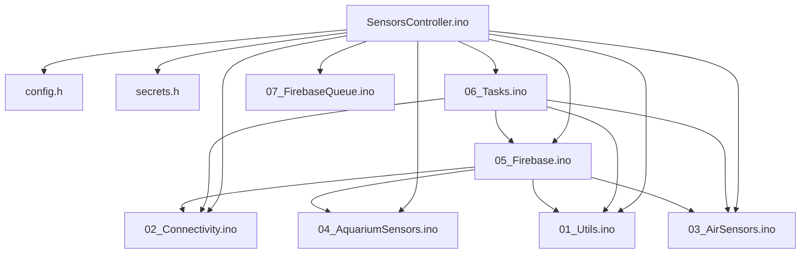
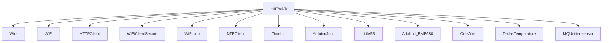
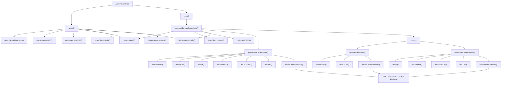

# DEPENDENCY_MAP

## Diagrama Geral

## Bibliotecas

## SensorsController.ino

### Responsabilidade

Declarar bibliotecas, objetos globais, variaveis de estado, `setup()` e `loop()`.

### Dependencias Diretas

- `Wire`
- `OneWire`
- `DallasTemperature`
- `MQUnifiedsensor`
- `WiFi`
- `HTTPClient`
- `WiFiClientSecure`
- `WiFiUdp`
- `NTPClient`
- `TimeLib`
- `ArduinoJson`
- `Adafruit_BME680`
- `config.h`
- `secrets.h`
- funcoes de todas as abas `.ino`

### Quem chama

- Runtime Arduino chama `setup()` e `loop()`.

### Quem e chamado

- `configurarMQ135`
- `configurarBME680`
- `conectarWiFi`
- `sincronizarHorario`
- `executarTarefasPeriodicas`
- `analogSetPinAttenuation`
- `pinMode`
- `digitalWrite`

### Impacto da alteracao

Critico. Afeta boot, globais e todo o firmware.

## config.h

### Responsabilidade

Centralizar pinos, limites eletricos, intervalos e parametros.

### Quem chama

Todos os arquivos que usam constantes.

### Impacto da alteracao

Critico para pinos, ADC e agenda; medio para tempos e limites de sensores.

## secrets.h

### Responsabilidade

Fornecer `ssid`, `password`, `FIREBASE_HOST`, `FIREBASE_AUTH`.

### Quem chama

- `SensorsController.ino`
- `02_Connectivity.ino`
- `05_Firebase.ino`

### Impacto da alteracao

Critico. Pode impedir Wi-Fi/Firebase e expor credenciais.

## 01_Utils.ino

### Responsabilidade

Formatar data/hora, validar NTP, montar caminhos historicos e caminho de status de sensores.

### Dependencias Diretas

- `timeClient`
- `WiFi.status()`
- TimeLib: `day`, `month`, `year`, `hour`, `minute`
- `MIN_VALID_YEAR`

### Quem chama

- `SensorsController.ino`
- `05_Firebase.ino`
- `06_Tasks.ino`

### Quem e chamado

- `timeClient.forceUpdate`
- `timeClient.getEpochTime`

### Impacto da alteracao

Alto. Pode alterar caminhos Firebase e agenda temporal.

## 02_Connectivity.ino

### Responsabilidade

Conectar Wi-Fi com timeout.

### Dependencias Diretas

- `WiFi`
- `ssid`
- `password`
- `WIFI_CONNECT_TIMEOUT_MS`

### Quem chama

- `SensorsController.ino`
- `06_Tasks.ino`

### Quem e chamado

- `WiFi.hostname`
- `WiFi.begin`
- `WiFi.status`
- `WiFi.localIP`

### Impacto da alteracao

Alto. Afeta NTP e Firebase.

## 03_AirSensors.ino

### Responsabilidade

Inicializar e ler BME680, calcular sensacao termica, inicializar/calibrar/ler MQ135.

### Dependencias Diretas

- `Wire`
- `bme680`
- `MQ135`
- constantes BME680/MQ135
- variaveis globais ambientais e de gases

### Quem chama

- `SensorsController.ino`
- `05_Firebase.ino`
- `06_Tasks.ino`

### Quem e chamado

- `Wire.begin`
- `bme680.begin`
- `bme680.performReading`
- `MQ135.init`
- `MQ135.update`
- `MQ135.calibrate`
- `MQ135.readSensor`

### Impacto da alteracao

Alto. Afeta qualidade dos dados de AirQuality.

## 04_AquariumSensors.ino

### Responsabilidade

Ler DS18B20, TDS, turbidez e pH. O DS18B20 e energizado por rele somente durante a janela de leitura.

### Dependencias Diretas

- `sensors`
- ADC
- constantes de pinos analogicos
- constantes do rele da temperatura/DS18B20
- buffers globais

### Quem chama

- `05_Firebase.ino`

### Quem e chamado

- `sensors.requestTemperatures`
- `sensors.getTempCByIndex`
- `analogRead`
- `digitalWrite`
- `getMedianNum`

### Impacto da alteracao

Alto. Afeta historico de Aquario.

## 05_Firebase.ino

### Responsabilidade

Criar JSONs de AirQuality/Aquario e gravar historico com HTTP REST.

### Dependencias Diretas

- `WiFi.status()`
- `WiFiClientSecure`
- `HTTPClient`
- `ArduinoJson`
- `FIREBASE_HOST`
- `FIREBASE_AUTH`
- `montarCaminhoHistorico`
- `montarCaminhoStatusSensores`
- `obterChaveHistoricoAtual`
- sensores de ar/aquario
- chaves globais de duplicidade

### Quem chama

- `SensorsController.ino`
- `06_Tasks.ino`

### Quem e chamado

- `lerBME680`
- `lerMQ135`
- `lerDS18B20`
- `lerPH`
- `lerTurbidez`
- `lerTDS`
- `HTTPClient.PUT`

### Impacto da alteracao

Critico. Afeta contrato Firebase.

## 06_Tasks.ino

### Responsabilidade

Orquestrar tarefas periodicas.

### Dependencias Diretas

- `WiFi`
- `timeClient`
- funcoes de conectividade, horario, Firebase e sensores
- constantes de agenda

### Quem chama

- `loop()` em `SensorsController.ino`.

### Quem e chamado

- `conectarWiFi`
- `timeClient.update`
- `calibrarMQ135`
- `sincronizarHorario`
- `gravarStatusSensores`
- `gravarHistoricoAtual`

### Impacto da alteracao

Critico. Afeta ordem e frequencia de todo o sistema.

## Call Graph

## 07_FirebaseQueue.ino

Responsabilidade: manter `/firebase-queue.jsonl` recuperavel via arquivo temporario e rename; enviar um item FIFO por ciclo e removê-lo apenas apos HTTP 200. Backoff progressivo de 30 s ate 1 h; limite 64 KiB/100 itens. Usa PUT em filho deterministico para retries idempotentes.
